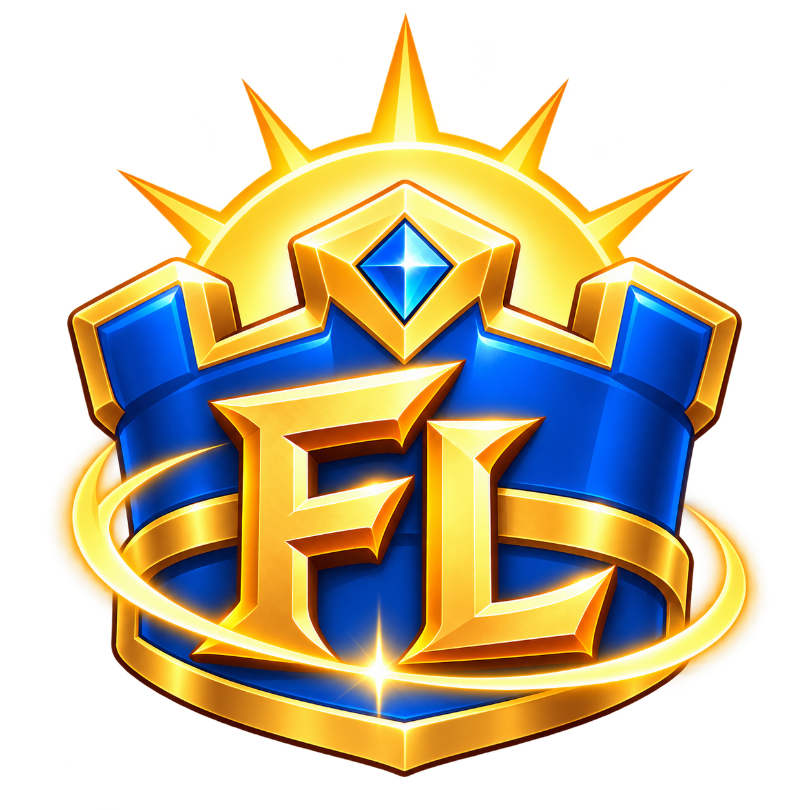
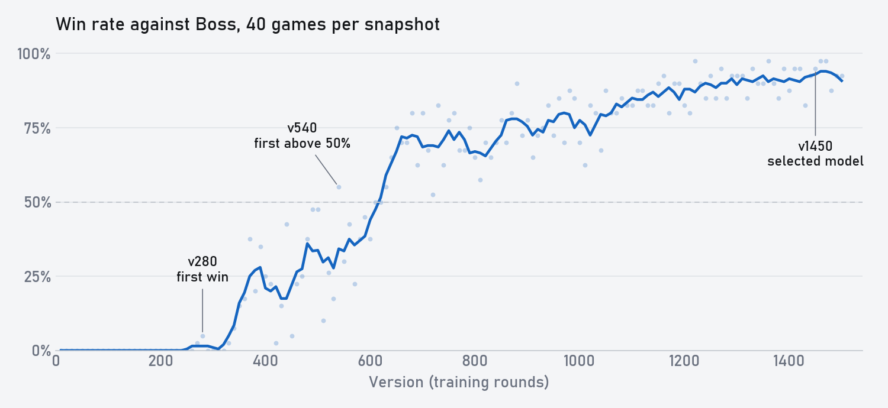

<p align="center">
  
</p>
<h1 align="center">FirstLight Zero</h1>
<p align="center">一个很小的皇室战争模型，不看任何人类数据，靠自博弈学会了 3.0 速弩内战。</p>
<p align="center"><a href="README.md">English</a> · <strong>简体中文</strong></p>
<p align="center">
  <a href="LICENSE"></a>
  
  
</p>
<p align="center">
  <a href="docs/training_history.zh-CN.md">训练历程</a> ·
  <a href="docs/training_metrics.zh-CN.md">训练指标</a> ·
  <a href="docs/getting_started.md">上手指南</a> ·
  <a href="docs/architecture.md">系统架构</a> ·
  <a href="docs/evaluation.md">评测</a> ·
  <a href="checkpoints/README.md">模型</a>
</p>

现在比较强的皇室战争 AI，都是先学人类对局数据。我想知道不看这些数据能不能也学好，所以这个模型从随机权重开始，只跟自己和自己的老版本打，卡组怎么用也没人教过它。

练了 1450 轮之后，这个 117 万参数的小模型赢下了一个 1679 万参数的模仿学习模型。后者是用 193,530 局顶尖天梯对局训练出来的。

<p align="center">
  
</p>

## 结果

40 局，速弩内战，11 级。`checkpoints/` 里有 v50 到 v1500 每 50 版一个模型，推荐用 v1450。

| 对手 | 大小 | 训练方式 | 我们的版本 | 胜率 |
|---|---|---|---|---|
| IL Model Everlight | 1679 万 | 193,530 局人类对局 | v1460 | 97.5% |

它没有参与过训练。[训练历程](docs/training_history.zh-CN.md)里有完整的胜率曲线和每个阶段打法的变化。

## 仓库内容

| 路径 | 内容 |
|---|---|
| `firstlight_zero/` | 训练和评测：特征、模型、采集、推理服务、PPO、胜率扫描和循环赛 |
| `native_runner/` | 从 FirstLight CR 精简来的对局环境层，探针源码在 `native_runner/probe/` |
| `tools/` | 评测服务、战术分析、回放导出和回放校验 |
| `checkpoints/` | 每 50 版一个模型，`firstlight-zero-v50.pt` 到 `firstlight-zero-v1500.pt` |
| `docs/` | 上面链接的各篇文档 |

## 快速开始

需要 Python 3.12、训练用的 GPU，以及 15.535.13 版本的原生对局引擎。本仓库不含游戏客户端。[FirstLight CR](https://github.com/Jaasssoooonnnnn/FirstLight_CR) 提供了完整的训练栈，可以用你自己提供的客户端构建引擎，包括探针、APK 工具、对局环境和训练指南。这份代码具体需要什么，见[上手指南](docs/getting_started.md)。

```bash
pip install -r requirements.txt
python tests/test_consistency.py      # 不需要引擎

cp engines.example.json engines.json  # 每个引擎进程一条
python firstlight_zero/launch.py prepare --run runs/first
python firstlight_zero/launch.py start --run runs/first > runs/first/supervisor.log 2>&1 &
python tools/status.py runs/first
```

想改训练参数，在 `prepare` 时加 `--set`。评测仓库里的模型见[使用预训练模型](docs/getting_started.md#4-use-the-pretrained-model)。

## 鸣谢

感谢 [daybreak-cr](https://github.com/Jason-XII/daybreak-cr)。这里的训练框架受它的异步训练框架启发，我的 PPO 训练吞吐比之前提高了 1.5 倍速。

## 许可

FirstLight Zero 是独立的离线项目，采用 [Apache-2.0](LICENSE) 许可，与 Supercell 没有关联。本项目不分发游戏及其资源，也不连接官方服务器。详见 [NOTICE](NOTICE)。
