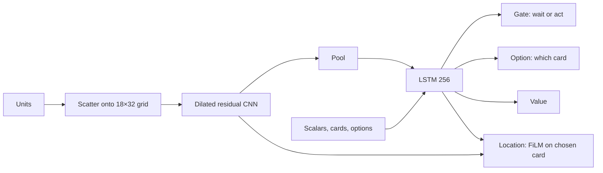

# Architecture

## The matchup

Both sides play the same deck at level 11 with princess towers: X-Bow, Hero Knight, Evo Archers, Evo Tesla, Skeletons, Electro
Spirit, Fireball and The Log. Hand order differs per game, so each side knows the deck but not the cycle.

The policy decides every 5 ticks (250 ms) and plays at most one card per decision. Each deployment uses the earliest legal delay
of 0–200 ms. A side that has not played after 15 seconds is forced to act once, with the policy still choosing card and tile.

## Observation

`firstlight_zero/features.py` turns one engine observation into a compact view from the seat's perspective; owner 1 is rotated
180 degrees so both sides see themselves at the bottom.

| Input | Contents |
|---|---|
| Scalars (31) | Clock, elixir, estimated enemy elixir, crowns, tower health, evolution progress, Hero ability windows |
| Own cards (8 × 5) | In hand, next, pending deployment and its target |
| Enemy cards (8 × 3) | Public availability and cycle distance inferred from plays |
| Options (5 × 3) | Four hand slots plus the Hero ability: cost, share of legal tiles, earliest delay |
| Units (up to 40 × 17) | Type embedding, position, health, velocity, attack phase, deployment, projectile flight |

The tensor schema is defined in `firstlight_zero/spec.py`.

## Network

`XbowNet` in `firstlight_zero/model.py`, 1.17M parameters. It is the FirstLight V4 model pruned for this mirror rather than a
new design: whatever stayed constant or zero over a sample of mirror games was removed.

The location head works on the CNN's board features, conditioned on the chosen card. This matters: an earlier design without a
board view learned the X-Bow but never learned Fireball or Tesla placement.

## Training loop

| Process | File | Role |
|---|---|---|
| Collector | `collector.py` | One per engine, 8 resident games. Featurizes, sends all seats of a frame to a server, steps the engine, writes episodes |
| Inference server | `server.py` | Batches decisions, keeps LSTM states by (client, seat), serves `current` and every snapshot |
| Learner | `learner.py` | Reads the inbox newest first, runs PPO with whole-episode BPTT, publishes weights and PFSP scores |
| Launcher | `launch.py`, `node.py` | Starts everything and restarts crashed collectors |

**Opponents.** Half of the games are current against current, and both seats train. The other half are current against a
snapshot, and only the current seat trains. Snapshots are drawn by PFSP with weight (1 − p)², where p is the recent score against
that snapshot, with a small uniform share so every snapshot keeps being measured.

**Reward** (`reward.py`). ±1 at the end, a potential on tower hit points (β = 0.2), penalties for elixir overflow (personal and
one-sided), and a penalty for activating your own King Tower. Rewards are zero-sum and identical for every card.

**Inference speed.** One CUDA graph per (model, batch-size bucket), replayed on each batch. History snapshots use coarse buckets
so that hundreds of models fit in graph memory. Check the `captures` count in `logs/server-*.jsonl` first when collection slows.

## Evaluation

`evaluate.py` uses the same servers with a per-seat sampling temperature. Opponents from the V4 family run on their own server
(`il_server.py`), which keeps the original tensorizer. See [evaluation and replays](evaluation.md).

## `native_runner`

A trimmed copy of the FirstLight CR battle environment: engine transport, contracts, card and rule data, the V4 tensorizer and
loader for opponents, and replay parsing. Only modules this project imports are kept. `native_runner/probe/` holds the matching
probe source.
