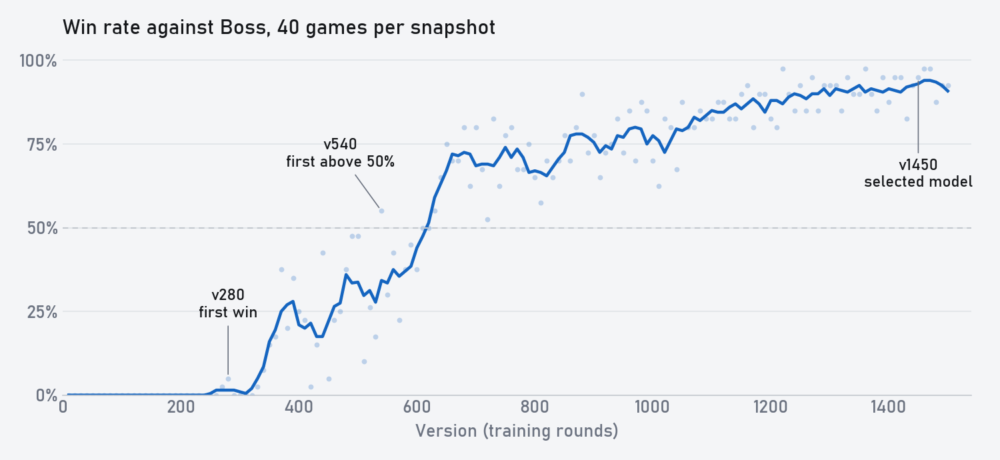
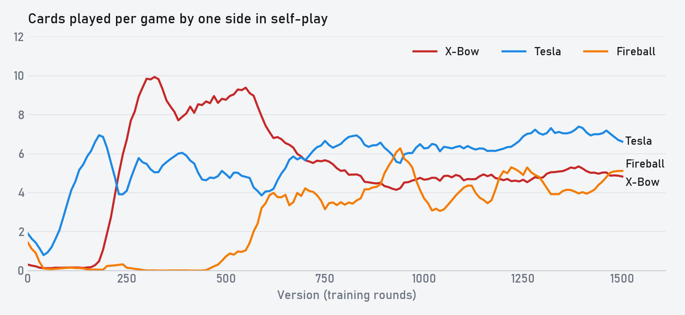

# Training history

[Home](../README.md) · [中文版](training_history.zh-CN.md) · [Model](../checkpoints/README.md) · [Evaluation commands](evaluation.md)

This is the written companion to the video. It follows the same run, `xm2-20261101d`, from its first game to the final model, with the training setup and the evaluation protocol.

Why start from zero? The strong Clash Royale AIs I know of all learn from human games first. I wanted to know whether a model could play well without ever seeing one, and whether it would find anything people hadn't. So I picked the smallest problem I could: one deck, played against itself.

## Setup

**Matchup.** Both sides play the same 3.0 X-Bow deck at level 11: X-Bow, Hero Knight, Evo Archers, Evo Tesla, Skeletons, Electro Spirit, Fireball and The Log. Hand order differs per game.

**Models.** The model has 1.17M parameters. It draws the units onto an 18×32 grid, reads the grid with a 4-layer dilated CNN, keeps memory in an LSTM, and decides every 250 ms whether to play, which card, and on which tile. [Architecture](architecture.md) has the details.

The yardstick is IL Model Everlight, an imitation model I call Boss.

| | FirstLight Zero | Boss |
|---|---|---|
| Parameters | 1.17M | 16.8M |
| CNN | 64 channels, 4 layers | 128 channels, 5 blocks |
| Recurrent | LSTM 256 | LSTM 768 |
| Relational transformer | No | Yes |
| Learned from | Self-play only | 193,530 human games |
| Decks | This mirror | Many |

Boss never takes part in training. It is only used to measure progress.

**Training.** Weights start random. Each round collects 1,024 episodes, runs PPO over them, and saves a new version, so v100 means 100 rounds. Half the games are current against current, with both seats training. The other half are current against an older snapshot, with only the current seat training. Snapshots are saved every 10 versions and picked by PFSP with weight (1 − p)², where p is the recent score against that snapshot, plus a 10% uniform share. Playing older versions matters because a policy that only meets its current self can forget how to beat what it used to do.

| Setting | Value |
|---|---|
| γ / λ | 0.9993 / 0.95 |
| Learning rate | 3e-4 |
| Clip / value clip | 0.2 / 0.5 |
| Entropy coefficient | 0.003 |
| Epochs per round | 2 |
| Minibatch | 8 whole episodes, BPTT over the full episode |
| Sampling temperature in training | 1.0 |

**Reward.** Four things and nothing about specific cards:

- ±1 for the result.
- A potential on tower hit points (β = 0.2).
- Penalties for elixir overflow: 0.0225 for your own, after a 4 elixir grace, and 0.075 when only you are overflowing.
- 0.1 for activating your own King Tower.

**Cost.** 1,500 rounds took 43.3 hours, about 104 seconds per round. v1450 was reached at hour 42.

## The curve

Every 10th snapshot played 40 games against Boss on the same 40 seeds, sampled at temperature 1.0 like training. Boss played argmax.

| Versions | Win rate against Boss |
|---|---|
| v10–v260 | 0% |
| v290–v350 | 4% |
| v360–v540 | 27% |
| v550–v650 | 46% |
| v660–v1100 | 74% |
| v1110–v1450 | 89% |

How the deck was used changed much more than the curve suggests. These numbers are from self-play, 20 games per version:

Self-play and games against Boss don't show the same thing, so below I keep them apart.

## v0: one card at a time

Self-play: it plays whatever is affordable the moment it lights up. It never saves elixir, presses the Hero ability six or seven times a game, and throws spells anywhere.

Against Boss: half the games end in three crowns, and the rest lose two towers.

## v50–v190: Knight and Archers, then Tesla

Self-play: by v50 the first real plan exists, Knight and Archers pushing together. It also learns to drop something next to an enemy push, since the tower loses less health that way. Fireball disappears, because a randomly aimed Fireball usually hits nothing while a unit placed anywhere still does something.

Then Tesla arrives. Plays per game go from under 1 at v60 to 7 at v190, for defense and for holding the bridge. Hero ability use falls from seven or eight a game to about two. Games that used to end 3–1 or 2–1 are almost all 1–0 from v50 on. There is still no elixir saving, no Fireball and no X-Bow.

Against Boss: it still loses every game, but it gets three-crowned far less often. Boss takes about two crowns a game.

## v200–v250: remembering the X-Bow

Self-play: v200 opens with an X-Bow and starts saving to six or seven elixir before playing. After that opening it still attacks with Knight and Archers. By v250 the X-Bow is the main attack. X-Bows per game go from 1 at v200 to 6.5 at v240 and over 10 at v300. Low-cost plays and Tesla drop.

The new style beats the old one easily: v250 crushes v150.

Against Boss: still no wins. Games stay around three minutes.

## v280–v500: the first win and peak X-Bow

Against Boss: v280 gets the first win, through better lane switching. This is also where games start to last. At v280, more than half of the 40 games go to overtime. By v350 the average game has grown from three minutes to four and a half.

Self-play: v300 learns the defensive X-Bow and plays about ten per game, its highest ever. By now this version and all of its older versions have stopped throwing Fireball, so nobody can remove a board full of X-Bows, and every self-play game runs the full five minutes. From v300 to v350 it learns to protect its X-Bow with Knight, Archers and Tesla, and attacking X-Bows live much longer. By v500 Knight and Log are better used, and it sometimes switches lanes to chain X-Bows.

Fireball comes back around v500 after two to three hundred versions away, mostly aimed at enemy defensive X-Bows. v500 beats v350 by taking the bridge better and wasting fewer defensive X-Bows.

Against Boss: v540 is the first snapshot above 50%, 22 of 40.

## v500–v650: Fireball becomes the second core

Self-play: by v600 Fireball is up to about 3 per game, used a lot in triple elixir to chip towers.

Against Boss: the fastest stretch of the run. The five snapshots from v600 to v640 average 52%, and by v650 it reaches 75%. Tower health follows: from v630 on, it finishes with more tower health than Boss.

## v650–v1100: fine details

Self-play: from v600 to v700 it plays far fewer X-Bows. It builds less on defense, and it would rather chip with Fireball. v700 and v800 look almost the same to me, but v800 handles details better and punishes more. The later versions are mostly like this: the style has settled and the work is in small details.

Here is how much newer versions beat older ones, 20 games per pair, sampled every 50 versions:

| Newer version | 50 back | 100 back | 150 back | All |
|---|---|---|---|---|
| v100–v500 | 77% | 95% | 96% | 88% |
| v550–v1000 | 66% | 73% | 89% | 76% |
| v1050–v1500 | 47% | 59% | 59% | 55% |

In the last stretch, 50 versions is too close to tell apart with 20 games per pair. The gain per version is small, though the curve against Boss keeps rising.

Against Boss: it holds at around 70–80%.

## v1100–v1450: up to 90%

Against Boss: the average over v1250–v1450 is 91%. Its fireballs at v1300 are mostly tower chip, measured from engine events at the moment each one lands: 80% hit a tower and 52% hit nothing else.

v1460 wins 97.5% against Boss, 39 of 40, and 7 of those games finish before overtime.

## Choosing the final model

The 10 best snapshots from the Boss sweep each played at 5 temperatures, and all 50 combinations played each other once from each seat, 2,450 games in total. Elo comes from Bradley–Terry with bootstrap intervals.

| Policy | Elo | 95% interval | P(best) |
|---|---|---|---|
| v1450, T 0.5 | +144 | 79 to 229 | 0.41 |
| v1470, T 0 | +128 | 59 to 212 | 0.25 |
| v1450, T 0 | +112 | 49 to 188 | 0.09 |
| v1470, T 0.5 | +104 | 33 to 180 | 0.11 |

Mean Elo by temperature:

| Temperature | 0 | 0.5 | 0.7 | 1.0 | 1.3 |
|---|---|---|---|---|---|
| Mean Elo | +28 | +46 | +22 | −20 | −76 |

Sampling at 0.5 beats both the training temperature and pure argmax.

v1450 at temperature 0.5 is the included checkpoint.

## Protocol

- Boss plays argmax. Zero samples at the stated temperature on gate, card and location.
- Both sides use the earliest legal delay, with a 200 ms ceiling.
- Both sides are forced to open after 15 seconds, with the policy choosing card and tile.
- No execution jitter.
- All 6,040 games against Boss were replayed in the engine from the recorded actions, and all of them matched.

[Evaluation](evaluation.md) has the commands.

## Limits

- This covers one deck. Change the deck and Zero can't play at all.
- All of this is model against model. It doesn't tell you how Zero does against strong human players.
