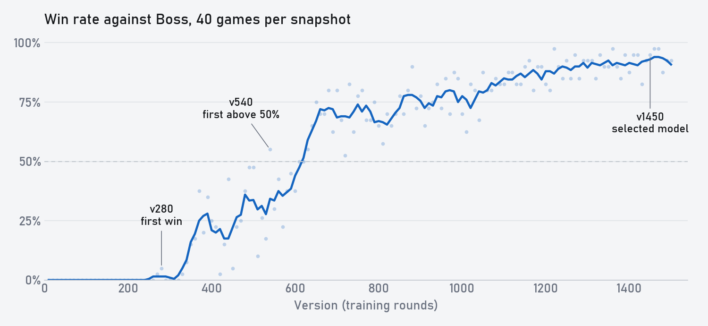
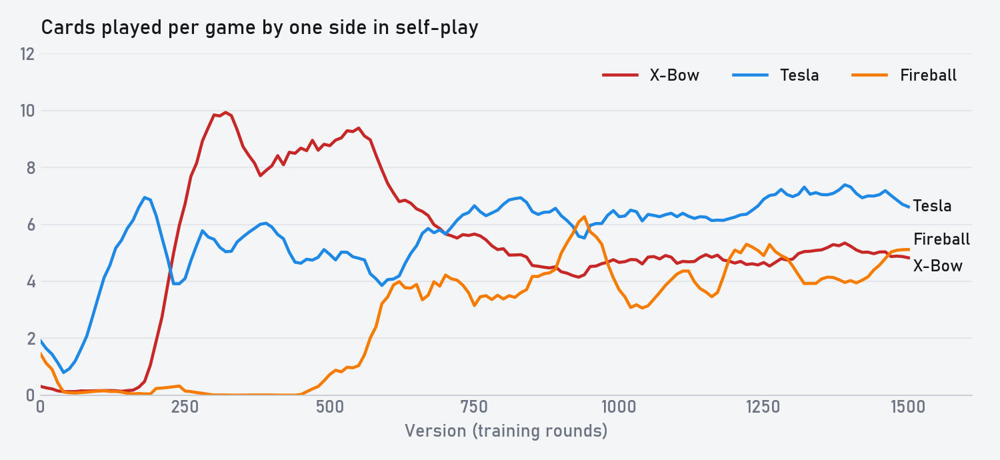

# 训练历程

[首页](../README.zh-CN.md) · [English](training_history.md) · [模型](../checkpoints/README.md) · [评测命令](evaluation.md)

这篇是视频的文字版，讲的是同一次训练 `xm2-20261101d`，从第一局一直到最终模型。视频里没细说的训练设置和评测方法都写在这里。

为什么要从零开始训？现在比较强的皇室战争 AI，都是先学人类对局数据。我想知道不看任何人类数据，AI 能不能自己学好，甚至找出人没想过的打法和思路。所以我挑了一个尽量小的问题：一套卡组，自己打自己。

## 训练设置

**对局。** 两边都用同一套 3.0 速弩，11 级：连弩、英雄骑士、觉醒弓箭手、觉醒特斯拉、骷髅、电气精灵、火球、滚木。每局手牌顺序不同。

**模型。** 模型一共 117 万参数。它先把场上单位画到 18×32 的格子图上，用 4 层空洞卷积看一遍，再用 LSTM 记住前面发生的事，每 250 毫秒决定一次：出不出牌，出哪张，下在哪一格。细节见[架构文档](architecture.md)。

用来衡量水平的是模仿学习模型 IL Model Everlight，我叫它 Boss。

| | FirstLight Zero | Boss |
|---|---|---|
| 参数 | 117 万 | 1679 万 |
| 卷积 | 64 通道，4 层 | 128 通道，5 个残差块 |
| 循环网络 | LSTM 256 | LSTM 768 |
| 关系 Transformer | 没有 | 有 |
| 学习来源 | 只有自博弈 | 193,530 局人类对局 |
| 卡组 | 只有这一套内战 | 很多套 |

Boss 不参与训练，只用来测进度。

**怎么练。** 权重随机初始化。每一轮采集 1024 个 episode，跑一次 PPO，存成一个新版本，所以 v100 就是练了 100 轮。一半的对局是当前版本打当前版本，两个座位都参与训练。另一半是当前版本打历史快照，只有当前版本那边参与训练。快照每 10 个版本存一次，按 PFSP 抽取，权重是 (1 − p)²，p 是最近对这个快照的得分率，另外留 10% 的均匀抽样。要打老版本，是因为只跟现在的自己打，容易忘了怎么赢以前的打法。

| 参数 | 数值 |
|---|---|
| γ / λ | 0.9993 / 0.95 |
| 学习率 | 3e-4 |
| clip / value clip | 0.2 / 0.5 |
| 熵系数 | 0.003 |
| 每轮 epoch | 2 |
| minibatch | 8 个完整 episode，整局 BPTT |
| 训练时采样温度 | 1.0 |

**奖励。** 只有四项，没有任何针对某张牌的奖励：

- 输赢 ±1。
- 塔血势能（β = 0.2）。
- 圣水溢出惩罚：自己溢出 0.0225，有 4 费宽限；只有自己溢出、对面没满时 0.075。
- 激活自己国王塔 0.1。

**耗时。** 1500 轮用了 43.3 小时，平均每轮约 104 秒，第 42 小时练到 v1450。

## 胜率曲线

每隔 10 个版本取一个快照，打 Boss 40 局，种子都一样。快照按训练时的温度 1.0 采样，Boss 用 argmax。

| 版本 | 对 Boss 胜率 |
|---|---|
| v10–v260 | 0% |
| v290–v350 | 4% |
| v360–v540 | 27% |
| v550–v650 | 46% |
| v660–v1100 | 74% |
| v1110–v1450 | 89% |

打法的变化比这条曲线大得多。下面是自博弈里的数据，每个版本 20 局：

自博弈和打 Boss 看到的东西不一样，所以下面分开写。

## v0：一张一张轮着出

自博弈：哪里亮了点哪里，完全不会攒费。英雄技能有就按，一局按六七次。法术随缘在扔。

打 Boss：一半的局被三冠，剩下的也要丢两座塔。

## v50–v190：骑士弓箭手，然后是特斯拉

自博弈：v50 有了第一版打法，骑士配弓箭手往前推。对面推过来，它也知道在对面的单位旁边下点牌，这样塔能少掉点血。火球消失了，因为随便砸的火球大多砸空，单位不管下在哪里都能起点作用。

接着特斯拉来了，每局从 v60 的不到 1 个涨到 v190 的 7 个，用来防守和抢桥头。英雄技能从七八次降到 2 次左右。早期常见的 3-1、2-1，从 v50 开始基本只剩 1-0。这时候它还是不会攒费，也不出火球和连弩。

打 Boss：还是全输，但被三冠的局少多了。Boss 每局拿它两冠左右。

## v200–v250：想起来自己是速弩

自博弈：v200 开局下连弩，也开始攒到六七费再出牌，不过开局之后进攻的还是骑士和弓箭手。到 v250，连弩成了主要进攻手段。每局连弩 v200 是 1 个，v240 是 6.5 个，v300 超过 10 个。低费牌和特斯拉都少了很多。

新打法打老版本很轻松，v250 把 v150 按在地上打。

打 Boss：还是赢不了，一局还是三分钟左右。

## v280–v500：第一次赢 Boss，和连弩最疯狂的时候

打 Boss：v280 靠更好的换路第一次赢了 Boss。对局也是从这时候开始变长，v280 的 40 局里有一半多进了加时，到 v350 平均一局从三分钟变成四分半。

自博弈：v300 学会了下防守弩，一局十个左右，是整个训练里最多的时候。这时候它和所有老版本都已经不扔火球了，满场的连弩没人能拆，所以每一局自博弈都打满五分钟。v300 到 v350，它学会了用骑士、弓箭手和特斯拉保护连弩，进攻弩活得久多了。到 v500，骑士和滚木用得更熟，有时候还会换路架连环弩。

火球在 v500 前后回来了，消失了两三百个版本之后，主要用来砸对面的防守弩。v500 打 v350，更会抢桥头，也少下了很多没用的防守弩。

打 Boss：v540 第一次过半，40 局赢 22 局。

## v500–v650：火球成了第二核心

自博弈：到 v600，火球涨到每局 3 个左右，三倍圣水时大量用来蹭塔。

打 Boss：这是整个训练里涨得最快的一段。v600 到 v640 这五个快照平均 52%，v650 到了 75%。塔血也跟上了，从 v630 开始，它剩下的塔血都比 Boss 多。

## v650–v1100：打法定型，开始抠细节

自博弈：v600 到 v700，连弩少了很多，一方面防守弩少了，一方面它更愿意用火球蹭血。v700 和 v800 我几乎看不出打法区别，但 v800 细节更好，更会抓机会。后面基本都是这样。

新版本打老版本的胜率如下，每隔 50 个版本测一次，每对 20 局：

| 新版本 | 差 50 版 | 差 100 版 | 差 150 版 | 合计 |
|---|---|---|---|---|
| v100–v500 | 77% | 95% | 96% | 88% |
| v550–v1000 | 66% | 73% | 89% | 76% |
| v1050–v1500 | 47% | 59% | 59% | 55% |

到最后一段，差 50 个版本用 20 局已经分不出来了。每一代的进步很小，但对 Boss 的曲线还在往上走。

打 Boss：这一段稳在七八成。

## v1100–v1450：磨到九成

打 Boss：v1250 到 v1450 平均 91%。v1300 的火球大多用来蹭塔，按引擎记录的落点事件统计，80% 打到了塔，52% 只打到了塔。

v1460 打 Boss 的胜率是 97.5%，40 局赢 39 局，其中有 7 局没进加时。

## 怎么选出最终模型

从 Boss 扫描里取最好的 10 个快照，每个配 5 个温度，50 个组合两两对打，每对各坐一次两边座位，一共 2450 局。Elo 用 Bradley–Terry 算，区间用 bootstrap。

| 策略 | Elo | 95% 区间 | P(最强) |
|---|---|---|---|
| v1450，T 0.5 | +144 | 79 到 229 | 0.41 |
| v1470，T 0 | +128 | 59 到 212 | 0.25 |
| v1450，T 0 | +112 | 49 到 188 | 0.09 |
| v1470，T 0.5 | +104 | 33 到 180 | 0.11 |

各温度的平均 Elo：

| 温度 | 0 | 0.5 | 0.7 | 1.0 | 1.3 |
|---|---|---|---|---|---|
| 平均 Elo | +28 | +46 | +22 | −20 | −76 |

T 0.5 比训练用的 1.0 强，也比纯 argmax 强。

仓库里的模型是 v1450 配 T 0.5。

## 评测条件

- Boss 用 argmax，Zero 按标明的温度对 gate、出牌和落点采样。
- 两边都用最早的合法延迟，上限 200 毫秒。
- 两边都是 15 秒没出牌就强制开牌，出哪张下在哪由策略决定。
- 没有执行抖动。
- 打 Boss 的 6040 局全部按记录的动作在引擎里重放过，结果全部一致。

命令见[评测文档](evaluation.md)。

## 局限

- 只有这一套卡组，换一套 Zero 根本不会打。
- 以上全是模型打模型，不能说明它对强人类玩家的表现。
