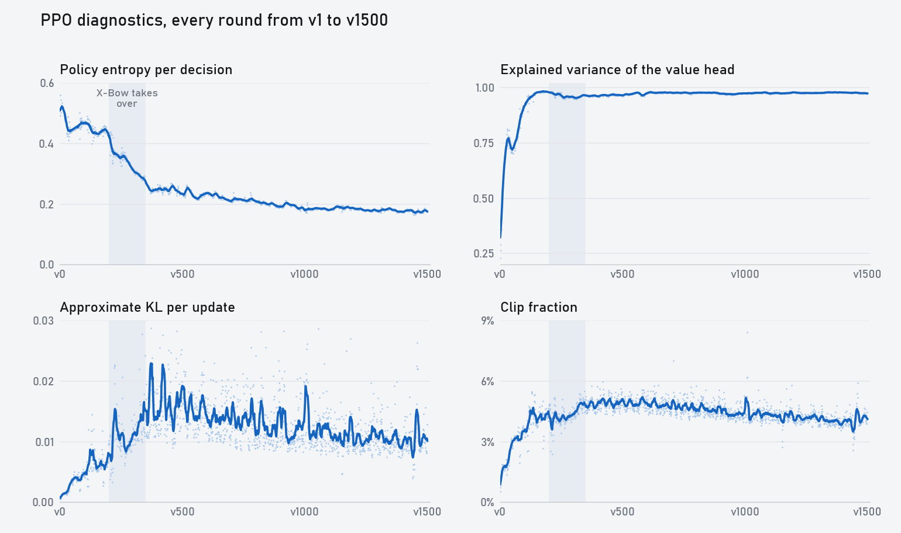
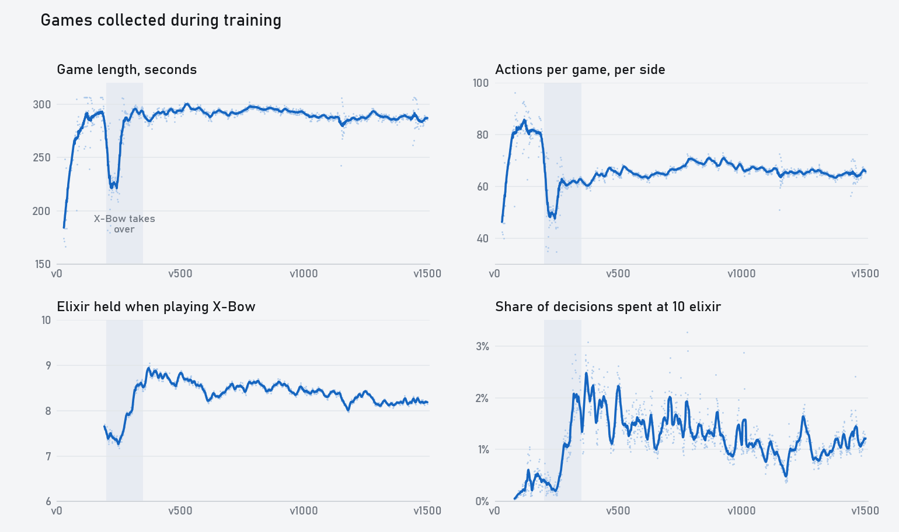

# Training metrics

[Home](../README.md) · [中文版](training_metrics.zh-CN.md) · [Training history](training_history.md) · [Getting started](getting_started.md)

The video skips most of this: the numbers PPO logged on every round of `xm2-20261101d`, and what changed in the games at the same time. [Training history](training_history.md) has the setup and the story of each version.

If you train your own run, the same fields end up in `runs/NAME/metrics.jsonl`, and `tools/status.py` prints the latest ones.

The shaded band in both charts is v200–v350, when the X-Bow became the main plan.

## PPO diagnostics

Each row is the mean over 50 rounds:

| Versions | Entropy | Explained variance | Approx KL | Clip fraction | Value loss | Grad norm |
|---|---|---|---|---|---|---|
| v51–100 | 0.459 | 0.817 | 0.0040 | 3.2% | 0.0081 | 0.11 |
| v151–200 | 0.439 | 0.981 | 0.0063 | 4.2% | 0.0051 | 0.17 |
| v251–300 | 0.342 | 0.958 | 0.0101 | 4.3% | 0.0085 | 0.16 |
| v351–400 | 0.251 | 0.963 | 0.0163 | 4.8% | 0.0069 | 0.17 |
| v551–600 | 0.227 | 0.972 | 0.0152 | 5.0% | 0.0063 | 0.16 |
| v1051–1100 | 0.184 | 0.977 | 0.0125 | 4.4% | 0.0059 | 0.13 |
| v1401–1450 | 0.178 | 0.977 | 0.0097 | 3.9% | 0.0059 | 0.13 |

The learning rate stays at 3e-4 and the entropy coefficient at 0.003 for the whole run. Nothing is annealed, so every change below comes from the policy and the games.

**Entropy.** This is the gate entropy on each decision, plus the card and tile entropy on decisions where it acts, in nats. It sits around 0.45 for the first 200 versions, falls to 0.25 by v350, then drifts down to 0.18.

The big drop lines up with the X-Bow. Once the model starts saving elixir, it acts less often: from 7.2% of decisions around v180 to 5.7% by v250. The win rate against Boss starts to move near the end of the drop: 4% for v290–v350, then 27% for v360–v540.

**Explained variance.** It starts at 0.29, passes 0.9 at v80 and 0.95 at v111. It peaks at 0.98 around v150–v200, drops to about 0.955 around v300 while the games change shape, and is back at 0.978 by v650.

High explained variance doesn't mean a strong model. v151–v200 has the highest value of the whole run, and those versions lost every game to Boss.

**KL and clip fraction.** KL climbs from 0.001 to about 0.017 around v400, then slowly falls to about 0.010. Clip fraction follows it, peaking at 5% and ending near 4%. The highest single round in the run was 8.4%.

**Value loss and grad norm.** Value loss is lowest before the X-Bow, at 0.005, jumps to 0.0097 around v250, and settles near 0.006. Grad norm peaks around 0.17. The round average never passed 0.28, well under the clip of 1.0.

## In the games

These come from the training games, so they mix current against current and current against older snapshots. Counts are per side.

**The dip at v200.** This is the sharpest change in the whole run:

| Versions | X-Bows per game | Actions per game | Game length | Crowns per game |
|---|---|---|---|---|
| v181–190 | 0.3 | 80 | 292 s | 0.58 |
| v221–230 | 4.1 | 49 | 224 s | 0.69 |
| v241–250 | 4.6 | 47 | 219 s | 0.64 |
| v271–280 | 8.6 | 62 | 287 s | 0.60 |
| v301–310 | 10.0 | 61 | 292 s | 0.59 |

For about 60 versions, the X-Bow attack was ahead of the defense and games ended more than a minute early. By v270 they were back near five minutes. Game length recovered, but actions per game never did. It stays in the 60s for the rest of the run, against 80 before the X-Bow.

**Saving elixir.** Mean elixir in hand when each card is played:

| Card | v51–100 | v151–200 | v351–400 | v551–600 | v1401–1450 |
|---|---|---|---|---|---|
| X-Bow | 8.1 | 8.0 | 8.8 | 8.5 | 8.2 |
| Knight | 3.7 | 5.3 | 6.4 | 6.8 | 6.8 |
| Archers | 4.1 | 5.5 | 6.5 | 7.0 | 6.7 |
| Tesla | 6.2 | 6.8 | 5.8 | 5.9 | 6.3 |
| Skeletons | 2.3 | 4.1 | 5.6 | 6.5 | 5.5 |
| Electro Spirit | 2.2 | 4.1 | 5.4 | 6.1 | 4.9 |
| Fireball | 8.2 | 7.5 | 6.7 | 8.5 | 6.7 |
| The Log | 2.8 | 4.5 | 5.0 | 6.0 | 5.1 |

X-Bow before v200 and Fireball before v500 come from very few plays.

Skeletons cost 1 elixir. At v51–100 it plays them at 2.3, close to the moment it can afford them. By v600 it plays them at 6.5, because it is holding elixir back for the X-Bow. After v600 the cheap cards come back down a little.

Time spent at 10 elixir is near zero while the model spends everything. It rises to about 2% around v400 once it starts saving, then settles near 1%.

**Older versions.** Half of the training games are against older snapshots. This is the score against them by how far back they are:

| Versions | Up to 20 back | 21–60 back | More than 60 back |
|---|---|---|---|
| v51–100 | 59% | 82% | 99% |
| v151–200 | 55% | 72% | 89% |
| v251–300 | 72% | 95% | 100% |
| v351–400 | 56% | 73% | 98% |
| v551–600 | 60% | 70% | 87% |
| v1051–1100 | 52% | 57% | 72% |
| v1401–1450 | 53% | 54% | 71% |

PFSP picks the snapshots the model struggles with, so these numbers are lower than a uniform sample would give.

v251–300 is the X-Bow jump: the new style beats almost everything before it. Late in the run, even versions more than 60 back take about 3 games in 10. That fits the [cross-version table](training_history.md#v650v1100-fine-details): progress per version gets small, though the win rate against Boss keeps rising.

## Checking your own run

These are the numbers from this run:

- Explained variance above 0.9 by about v80.
- Clip fraction between 3% and 5% after v100.
- KL between 0.005 and 0.02 after v100.
- Entropy falling in steps as the play style changes.
- A sudden change in game length or actions per game usually means a new strategy, so check the replays before you decide something broke.
