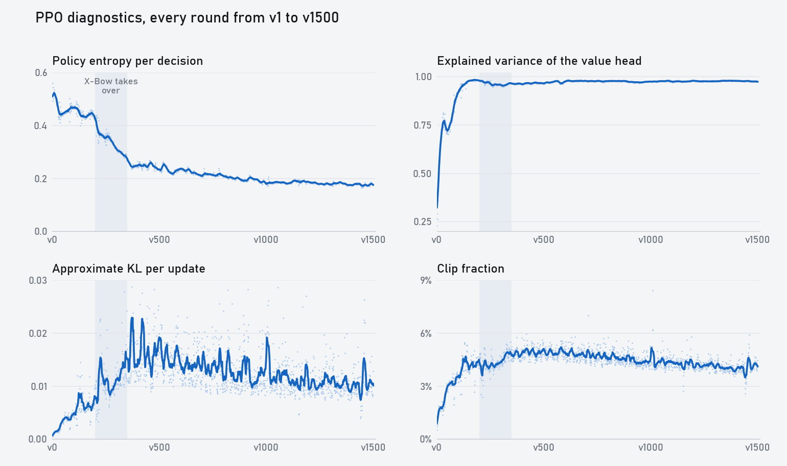
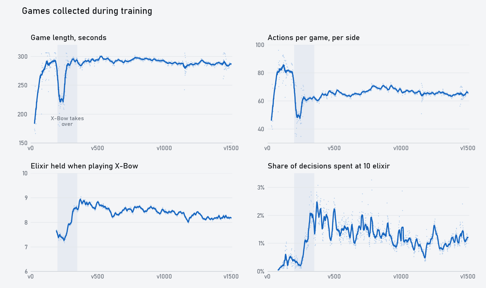

# 训练指标

[首页](../README.zh-CN.md) · [English](training_metrics.md) · [训练历程](training_history.zh-CN.md) · [上手指南](getting_started.md)

视频里基本没讲这些：`xm2-20261101d` 每一轮 PPO 记录的数字，以及同一时期对局发生的变化。训练设置和每个版本的打法见[训练历程](training_history.zh-CN.md)。

如果你自己训练，同样的字段会写进 `runs/NAME/metrics.jsonl`，`tools/status.py` 可以打印最新的数值。

两张图里的阴影是 v200–v350，也就是连弩变成主要打法的阶段。

## PPO 指标

每行是 50 轮的平均值：

| 版本 | 熵 | Explained variance | Approx KL | Clip fraction | Value loss | Grad norm |
|---|---|---|---|---|---|---|
| v51–100 | 0.459 | 0.817 | 0.0040 | 3.2% | 0.0081 | 0.11 |
| v151–200 | 0.439 | 0.981 | 0.0063 | 4.2% | 0.0051 | 0.17 |
| v251–300 | 0.342 | 0.958 | 0.0101 | 4.3% | 0.0085 | 0.16 |
| v351–400 | 0.251 | 0.963 | 0.0163 | 4.8% | 0.0069 | 0.17 |
| v551–600 | 0.227 | 0.972 | 0.0152 | 5.0% | 0.0063 | 0.16 |
| v1051–1100 | 0.184 | 0.977 | 0.0125 | 4.4% | 0.0059 | 0.13 |
| v1401–1450 | 0.178 | 0.977 | 0.0097 | 3.9% | 0.0059 | 0.13 |

学习率全程 3e-4，熵系数全程 0.003，都没有衰减，所以下面这些变化都来自策略和对局本身。

**熵。** 每次决策的 gate 熵，加上出牌时的卡牌熵和格子熵，单位是 nat。前 200 个版本基本停在 0.45 左右，到 v350 降到 0.25，之后慢慢降到 0.18。

这次大幅下降和连弩同步。模型开始存圣水以后，出手就少了：出手决策的占比从 v180 附近的 7.2% 降到 v250 的 5.7%。打 Boss 的胜率也在下降快结束时开始动起来：v290–v350 是 4%，v360–v540 是 27%。

**Explained variance。** 从 0.29 开始，v80 过 0.9，v111 过 0.95。v150–v200 到达最高的 0.98，v300 附近对局形态变了，掉到 0.955 左右，到 v650 回到 0.978。

这个值高不代表模型强。v151–v200 是整个训练里最高的一段，而这些版本打 Boss 一局都赢不了。

**KL 和 clip fraction。** KL 从 0.001 涨到 v400 附近的 0.017 左右，然后慢慢降到 0.010 左右。Clip fraction 跟着变化，最高 5%，最后在 4% 附近。单轮最高是 8.4%。

**Value loss 和 grad norm。** Value loss 在连弩出现之前最低，是 0.005，v250 附近跳到 0.0097，之后稳定在 0.006 左右。Grad norm 最高 0.17 左右，单轮平均值没有超过 0.28，离 1.0 的裁剪阈值很远。

## 对局里的变化

这些数据来自训练对局，包括当前版本打当前版本，也包括当前版本打旧版本。次数都按单方计算。

**v200 的低谷。** 这是整个训练里变化最剧烈的一段：

| 版本 | 每局连弩数 | 每局动作数 | 对局时长 | 每局皇冠数 |
|---|---|---|---|---|
| v181–190 | 0.3 | 80 | 292 秒 | 0.58 |
| v221–230 | 4.1 | 49 | 224 秒 | 0.69 |
| v241–250 | 4.6 | 47 | 219 秒 | 0.64 |
| v271–280 | 8.6 | 62 | 287 秒 | 0.60 |
| v301–310 | 10.0 | 61 | 292 秒 | 0.59 |

大约有 60 个版本，连弩进攻跑在防守前面，对局提前一分多钟结束。到 v270，对局又回到接近五分钟。时长恢复了，每局动作数却没有回去，之后一直在 60 多，而连弩出现之前是 80。

**存圣水。** 下每张牌时手里的平均圣水：

| 卡牌 | v51–100 | v151–200 | v351–400 | v551–600 | v1401–1450 |
|---|---|---|---|---|---|
| 连弩 | 8.1 | 8.0 | 8.8 | 8.5 | 8.2 |
| 骑士 | 3.7 | 5.3 | 6.4 | 6.8 | 6.8 |
| 弓箭手 | 4.1 | 5.5 | 6.5 | 7.0 | 6.7 |
| 特斯拉 | 6.2 | 6.8 | 5.8 | 5.9 | 6.3 |
| 骷髅兵 | 2.3 | 4.1 | 5.6 | 6.5 | 5.5 |
| 电精灵 | 2.2 | 4.1 | 5.4 | 6.1 | 4.9 |
| 火球 | 8.2 | 7.5 | 6.7 | 8.5 | 6.7 |
| 滚木 | 2.8 | 4.5 | 5.0 | 6.0 | 5.1 |

v200 之前的连弩和 v500 之前的火球，出牌次数都很少。

骷髅兵只要 1 费。v51–100 时它在 2.3 圣水下牌，基本是够了就下。到 v600 变成 6.5，因为它开始给连弩留圣水了。v600 之后，低费牌的数字又回落了一点。

模型什么都花掉的时候，满圣水的时间接近 0。开始存圣水后，v400 附近涨到 2% 左右，之后稳定在 1% 左右。

**打旧版本。** 训练里有一半对局是打旧快照。下面是按版本差距统计的得分：

| 版本 | 差 20 版以内 | 差 21–60 版 | 差 60 版以上 |
|---|---|---|---|
| v51–100 | 59% | 82% | 99% |
| v151–200 | 55% | 72% | 89% |
| v251–300 | 72% | 95% | 100% |
| v351–400 | 56% | 73% | 98% |
| v551–600 | 60% | 70% | 87% |
| v1051–1100 | 52% | 57% | 72% |
| v1401–1450 | 53% | 54% | 71% |

PFSP 会多选模型打不过的快照，所以这些数字比均匀抽样要低。

v251–300 就是连弩带来的跳跃，新打法几乎碾压之前所有版本。到训练后期，差 60 版以上的旧版本也能拿到大约三成得分。这和[跨版本对战表](training_history.zh-CN.md#v650v1100打法定型开始抠细节)是一致的：每一版的进步变小了，但打 Boss 的胜率还在涨。

## 检查你自己的训练

这次训练的数字是这样的：

- Explained variance 在 v80 左右超过 0.9。
- v100 之后 clip fraction 在 3% 到 5% 之间。
- v100 之后 KL 在 0.005 到 0.02 之间。
- 熵随打法变化一段一段地降。
- 对局时长或每局动作数突然变化，通常说明出现了新打法。先看录像，再判断是不是出了问题。
